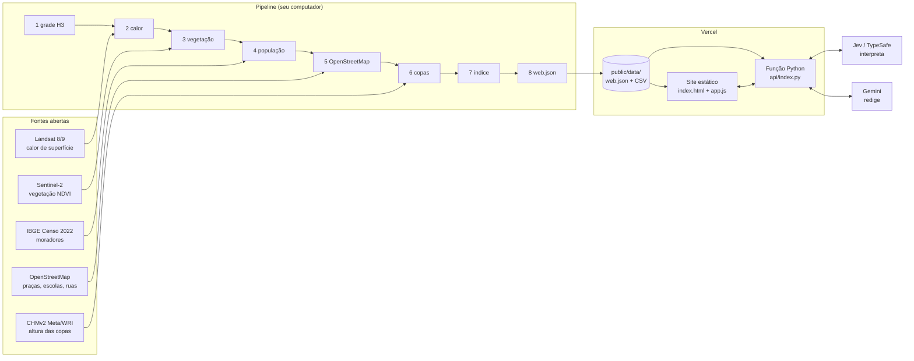
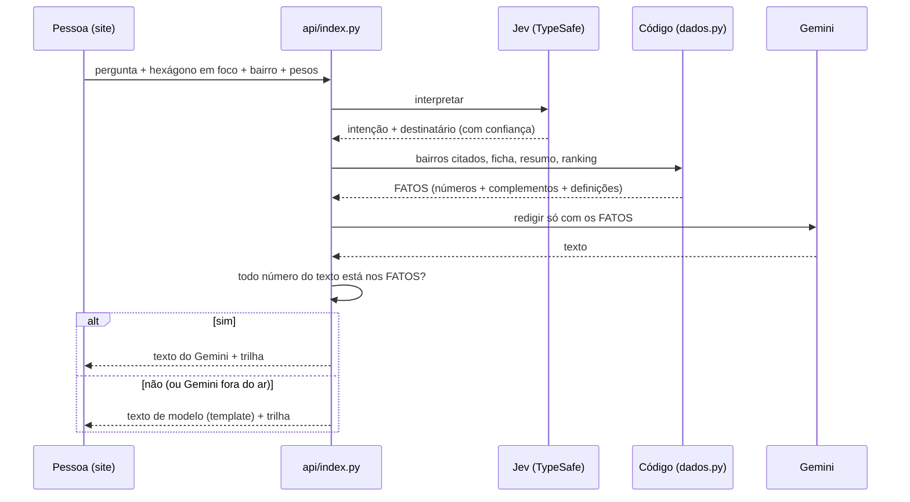

# Mirá — onde plantar árvores em Manaus

**Mirá** quer dizer “árvore” em nheengatu, a língua geral amazônica (Navarro, *Curso de Língua Geral*, USP).

O Mirá mostra **onde uma árvore nova faz mais diferença** em Manaus. A cidade é dividida em 32 mil hexágonos de cerca de 120 m, mais ou menos uma quadra. Cada um recebe uma nota de 0 a 100 que combina três coisas: quanto a superfície esquenta, quanta vegetação falta e quantas pessoas moram ali. O site também mostra onde Manaus perdeu árvores e tem um assistente que explica os dados e redige ofícios para pedir o plantio.

- **Site:** https://mira.eco.br
- **Projeto irmão:** [Akub](https://akub-alpha.vercel.app/), o calor urbano em Manaus hora a hora
- **Autor:** Prof. Dr. Fabio Santos (EST/UEA e LSI) · fssilva@uea.edu.br · piloto em Manaus

> O índice indica **onde priorizar**. A escolha das espécies (de preferência nativas) e a viabilidade de cada local (calçada, fiação, tubulação, solo) dependem de avaliação técnica em campo.

---

## Sumário

1. [Para quem é](#1-para-quem-é)
2. [Visão geral: como as peças se encaixam](#2-visão-geral-como-as-peças-se-encaixam)
3. [O índice em cinco minutos](#3-o-índice-em-cinco-minutos)
4. [Guia do site](#4-guia-do-site)
5. [Estrutura do repositório](#5-estrutura-do-repositório)
6. [Pipeline de dados (etapas 1 a 8)](#6-pipeline-de-dados-etapas-1-a-8)
7. [Metodologia detalhada](#7-metodologia-detalhada)
8. [Copas de árvores e visão computacional](#8-copas-de-árvores-e-visão-computacional)
9. [O assistente (Jev + Gemini)](#9-o-assistente-jev--gemini)
10. [Como rodar](#10-como-rodar)
11. [Como publicar (GitHub + Vercel)](#11-como-publicar-github--vercel)
12. [Testes](#12-testes)
13. [Dados abertos (saídas)](#13-dados-abertos-saídas)
14. [Resultados atuais](#14-resultados-atuais)
15. [Limites](#15-limites)
16. [O que ainda pode ser feito com LLMs e VLMs](#16-o-que-ainda-pode-ser-feito-com-llms-e-vlms)
17. [Glossário](#17-glossário)
18. [Fontes, licenças e créditos](#18-fontes-licenças-e-créditos)

---

## 1. Para quem é

| Público | Para que usa |
|---|---|
| **Gestores públicos** | Priorizar onde plantar com critério explícito e auditável; relatório por bairro em PDF; dados abertos em CSV |
| **Associações de bairro e escolas** | Entender a situação do bairro, achar os pontos mais prioritários e gerar um **ofício pronto** para pedir o plantio |
| **Moradores** | Ver o mapa, clicar na própria quadra e perguntar "por que aqui?" em linguagem simples |
| **Pesquisa e ensino** | Exemplo completo de dados de satélite + censo + visão computacional + agente com LLM, com verificação dos números |

---

## 2. Visão geral: como as peças se encaixam

O projeto tem **três camadas**. O pipeline roda no seu computador e produz arquivos. O site e o assistente só **leem** esses arquivos: nada é calculado por um LLM.



| Camada | Onde roda | O que faz | Tecnologias |
|---|---|---|---|
| **Pipeline** | seu computador | baixa os dados, recorta Manaus, agrega por hexágono, calcula o índice e gera `public/data/` | Python, rasterio, geopandas, h3, STAC (Planetary Computer), osmnx |
| **Site** | Vercel (CDN) | mapa interativo, ficha, pesos ajustáveis, ranking, relatório, camadas de copas | HTML, JavaScript, Leaflet, h3-js, canvas |
| **Assistente** | Vercel (função Python) | responde perguntas e redige ofícios só com os dados do Mirá | FastAPI, Jev (TypeSafe), Gemini |

---

## 3. O índice em cinco minutos

**1. A cidade vira uma colmeia.** Manaus urbana é coberta por **32.216 hexágonos** H3 de ~15 mil m² (~120 m). É o tamanho do pixel térmico do Landsat: menor que isso, o dado não enxerga.

**2. Cada hexágono recebe três notas.** Cada nota é um **percentil**, ou seja, uma comparação com o resto da cidade:

| Fator | Pergunta | Dado |
|---|---|---|
| Calor | Quanto mais quente que a mediana da cidade? | Landsat, estação seca |
| Falta de verde | Quanta vegetação falta? | NDVI do Sentinel-2 |
| Moradores | Quantas pessoas moram ali? | Censo 2022, com +50% de peso para idosos e crianças de 0 a 4 anos |

Percentil 96 em calor quer dizer "mais quente que 96% dos hexágonos".

**3. A nota final é uma média ponderada.** Índice = 100 × (40% calor + 30% falta de verde + 30% moradores). Os pesos podem ser mudados no site.

**4. As faixas dizem a urgência.** **Muito alta** são os 10% mais prioritários da cidade; **alta**, do 10% ao 25%; **média**, do 25% ao 50%; **baixa**, a metade de baixo.

**5. "Robusto" é a escolha segura.** O hexágono fica entre os 10% do topo com **cinco conjuntos de pesos diferentes**. Nenhum critério razoável o tira de lá.

**6. Alguns lugares ficam de fora:** água, aeroporto, mata densa (que é para proteger, e não plantar) e falta de dado de satélite.

**Exemplo real.** O hexágono nº 1 de Manaus fica no Lírio do Vale. É mais quente que 96% da cidade (+6,6 °C), tem 0% de cobertura vegetal (menos verde que 90%) e cerca de 415 moradores (mais que em 99%). O índice é 95, a faixa é muito alta e ele é robusto.

```
100 × (0,4 × 0,96 + 0,3 × 0,90 + 0,3 × 0,99) = 95
```

---

## 4. Guia do site

| Parte | O que faz |
|---|---|
| **Números do topo** | Hexágonos elegíveis, quantos estão em prioridade muito alta, moradores nessas áreas e quanto a superfície esfria a cada +10 pontos de vegetação |
| **Mapa, aba Prioridade** | Faixa de cada hexágono; "Só os robustos" apaga o resto |
| **Abas Calor, Vegetação e Moradores** | Cada fator separado |
| **Aba Copas** | Copa de árvores (altura ≥ 3 m) nas imagens de **2010–2019**: o passado |
| **Aba Perda de copa** | Onde havia árvores em 2010–2019 e hoje há pouco verde: provável desmatamento ou obra |
| **Ficha do hexágono** | Índice, faixa, posição na cidade e no bairro, as três barras de percentil, o espaço registrado no OpenStreetMap, a copa, o aviso de perda e o link para o Google Maps |
| **Pesos do índice** | Muda a importância dos fatores; mapa, ficha, ranking e assistente se recalculam **no navegador** |
| **Pergunte ao Mirá** | Assistente: explica pontos, bairros e a cidade, e redige ofícios |
| **Bairros** | Ranking ordenável; clicar abre o **relatório do bairro** (imprimir/PDF, botão "Redigir ofício") |
| **Verde e calor** | Relação observada entre vegetação e temperatura de superfície, com intervalo de confiança |
| **Por onde começar** | Tipos de espaço registrado nos hexágonos de prioridade muito alta |
| **Metodologia** | Resumo das fontes e regras, gerado a partir dos metadados |

**Diferença entre as camadas de verde:** *Vegetação* é o verde **de hoje** (inclui gramado). *Copas* são as árvores **de 2010–2019**. *Perda de copa* é a **comparação** entre as duas.

---

## 5. Estrutura do repositório

```
plantio-manaus/
├── pipeline/                 dados → public/data (roda no seu computador)
│   ├── comum.py              caminhos, grade H3, raster → hexágono
│   ├── 01_grade.py … 08_web.py
│   └── rodar_tudo.py         executa as etapas em ordem
├── api/                      assistente (função Python no Vercel)
│   ├── index.py              FastAPI: /api/agente e /api/status, limite por visitante
│   └── _agente/
│       ├── dados.py          lê web.json e reproduz o cálculo do site
│       ├── decisao.py        fluxo: Jev → código → Gemini → conferência
│       ├── jev.py            cliente do Jev + simulador sem chave
│       └── gemini.py         cliente do Gemini com modelo reserva
├── public/                   site estático (servido pela CDN)
│   ├── index.html            layout, estilos, textos
│   ├── app.js                mapa, ficha, pesos, ranking, relatório
│   ├── agente.js             conversa e trilha de decisão
│   └── data/                 web.json (site) + CSV/JSON abertos
├── explorar/copas_chmv2.py   análise exploratória CHMv2 × NDVI (não altera o site)
├── testes/                   pipeline sintético e testes do assistente
├── dados/                    entradas e intermediários (ignorados pelo Git, exceto bairros.geojson)
├── cache/                    downloads reaproveitáveis (ignorado)
├── requirements.txt          dependências do SERVIDOR (o Vercel instala este)
├── requirements-pipeline.txt dependências do PIPELINE
├── vercel.json               função Python e rota /api/*
├── .vercelignore             o que não sobe para o Vercel
└── .env.example              modelo das chaves (o .env real nunca vai para o Git)
```

---

## 6. Pipeline de dados (etapas 1 a 8)

```bash
python pipeline/rodar_tudo.py                 # todas as etapas
python pipeline/rodar_tudo.py --a-partir-de 6 # retoma da etapa 6
python pipeline/rodar_tudo.py --so 7 -- --peso-calor 0.5 --peso-verde 0.3 --peso-pessoas 0.2
```

| # | Script | O que faz | Saída | Tempo | Baixa |
|---|---|---|---|---|---|
| 1 | `01_grade.py` | Hexágonos H3 (res. 10) com centro dentro dos 63 bairros do IBGE | `grade.parquet` | segundos | nada |
| 2 | `02_calor.py` | Temperatura de superfície do Landsat, anomalia em relação à cidade, mediana entre cenas | `calor.parquet` | 10–30 min | ~25 cenas (recorte) |
| 3 | `03_vegetacao.py` | NDVI, cobertura vegetal e água do Sentinel-2 | `vegetacao.parquet` | 15–40 min | até 16 cenas (recorte) |
| 4 | `04_populacao.py` | Moradores, idosos e crianças por setor, redistribuídos nos hexágonos | `populacao.parquet` | 2–5 min | ~135 MB do IBGE (cache) |
| 5 | `05_viabilidade.py` | Praças, escolas, ruas, avenidas e aeroporto (OpenStreetMap) | `viabilidade.parquet` | 1–5 min | Overpass |
| 6 | `06_copas.py` | Copa (altura ≥ 3 m) e altura média, do CHMv2 | `copas.parquet` | 2–5 min | recorte do CHMv2 |
| 7 | `07_indice.py` | Exclusões, percentis, índice, faixas, robustez, oportunidade, perda de copa, relação verde–calor | `public/data/*.csv`, `*.json` | segundos | nada |
| 8 | `08_web.py` | Compacta tudo em `web.json` (colunar, inteiros escalados) | `public/data/web.json` | segundos | nada |

As etapas 1 a 6 gravam em `dados/intermediario/`; as etapas 7 e 8 gravam em `public/data/`. O arquivo `dados/entrada/bairros.geojson` (malha de bairros do IBGE, a mesma do Akub) já vem no repositório.

**Quando rodar de novo:** uma vez por ano, depois da estação seca (julho a outubro), para atualizar calor e vegetação. A população muda com um novo censo. O OpenStreetMap pode ser atualizado a qualquer momento (`--a-partir-de 5`).

---

## 7. Metodologia detalhada

**Grade.** Hexágonos H3 na resolução 10 (~15 mil m², ~120 m de diâmetro) cujo centro está dentro de um dos 63 bairros da malha do IBGE (Censo 2022). O tamanho acompanha a resolução nativa da banda térmica do Landsat (100 m): uma grade menor sugeriria um detalhe que o dado não tem.

**Calor.**
- Fonte: Landsat 8/9, Coleção 2, Nível 2, banda ST_B10, convertida com escala 0,00341802 e offset 149.
- Cenas: julho a outubro (estação seca), com menos de 40% de nuvem.
- Máscara: nuvem, sombra, cirro e água são removidos pela banda QA_PIXEL.
- Por cena: a anomalia do hexágono é a diferença entre a mediana dos seus pixels e a mediana de todos os hexágonos. Entram só cenas que cobrem ao menos 80% da grade, para que a referência seja sempre a cidade inteira.
- Valor final: a mediana entre cenas.
- É a temperatura **da superfície** por volta das 10h, e não a temperatura do ar.

**Vegetação.**
- Fonte: Sentinel-2 L2A (10 m), julho a outubro, até 16 cenas com menos de 20% de nuvem.
- Correção: nas cenas com processamento 04.00 ou posterior, desconta-se o deslocamento de 1000 nas reflectâncias.
- Pixels válidos pela banda SCL (vegetação, solo, água, não classificado).
- Por hexágono: NDVI mediano, cobertura vegetal (fração de pixels de terra com NDVI ≥ 0,5) e fração de água. Valor final: mediana entre cenas.

**Pessoas.**
- Fonte: Censo 2022, agregados por setor censitário.
- Variáveis: total de pessoas (V0001), idosos de 60 anos ou mais (V01018, V01019, V01029, V01030) e crianças de 0 a 4 anos (V01009, V01020). Valores suprimidos por sigilo contam como ausentes.
- Distribuição: a população de cada setor é repartida entre os hexágonos que ele toca, proporcionalmente à área sobreposta multiplicada pela habitabilidade do hexágono, (1 − fração de água) × (1 − 0,8 × cobertura vegetal). Assim ninguém é posto em rio ou mata.

**Tipo de oportunidade (informativo, não entra no índice).** Cada hexágono recebe o primeiro tipo que se aplica:
1. **Praça ou área pública** (≥ 500 m²)
2. **Escola ou creche**
3. **Avenida com canteiro** (≥ 100 m de via principal)
4. **Ruas locais** (≥ 100 m; dependem da largura da calçada)
5. **Sem registro no OpenStreetMap**

O OpenStreetMap é incompleto e não informa a largura das calçadas, então a falta de registro não significa falta de espaço.

**Exclusões.** Não recebem índice os hexágonos com:
- mais de 50% de água;
- área aeroportuária;
- vegetação já densa: cobertura ≥ 60% **e** copa de árvores ≥ 30%. São áreas para proteger, e não para plantar; gramados e pastos continuam no índice;
- falta de dado de satélite.

**Índice.** Entre os hexágonos elegíveis, cada fator vira um percentil de 0 a 1: calor (anomalia), verde (NDVI invertido) e pessoas (moradores + 50% para idosos e crianças). Índice = 100 × média ponderada, com pesos padrão de 0,4, 0,3 e 0,3. Faixas pelo percentil do índice: muito alta (≥ 90), alta (75–90), média (50–75), baixa (< 50).

**Robustez.** O índice é recalculado com quatro outros conjuntos de pesos: iguais; ênfase em calor (0,6/0,2/0,2); em verde; em pessoas. É robusto o hexágono que fica entre os 10% do topo em todos os cinco.

**Relação vegetação–calor.** Regressão linear da anomalia de superfície sobre a cobertura vegetal, nos hexágonos sem água nem aeroporto. O intervalo de confiança de 95% vem de 500 reamostragens de **bairros inteiros**: hexágonos vizinhos não são independentes, e reamostrá-los um a um daria uma confiança falsa. É uma associação observada em Manaus, e não uma garantia de quanto cada árvore resfria.

---

## 8. Copas de árvores e visão computacional

**O problema.** O NDVI mede "planta viva" pela cor (infravermelho × vermelho). Gramado e árvore saem parecidos, mas só a árvore faz sombra.

**A solução.** O Mirá usa o **CHMv2**, um mapa global de **altura das copas** com ~1,2 m por pixel, publicado pela Meta e pelo WRI (CC BY 4.0). Ele foi gerado por um **modelo de visão computacional**:
- um *backbone* **DINOv3**, um Vision Transformer auto-supervisionado, pré-treinado em imagens de satélite;
- uma cabeça de **regressão densa**, no estilo da estimativa de profundidade monocular, treinada com alturas medidas por **LiDAR**.

Para cada pixel de uma foto de satélite comum, o modelo estima a altura do que está ali, a partir de pistas como sombra, textura e forma da copa.

**Como o Mirá usa o mapa** (`06_copas.py`):
1. Lê pelo índice `tiles.parquet` só os 4 tiles que cobrem Manaus, direto do Source Cooperative, por requisições HTTP por faixa em COGs. Não baixa os 24 TB do mundo.
2. Marca como **copa** os pixels com altura ≥ 3 m e agrega por blocos de ~19 m e depois por hexágono: **fração de copa** e **altura média**.
3. Guarda o período das imagens de origem, que vai de **2010 a 2019** conforme o tile.

**Por que a copa não substitui o NDVI no índice.** A comparação está em `explorar/copas_chmv2.py`:
- Correlação NDVI × copa: **0,87** em 32 mil hexágonos.
- O NDVI recente explica um pouco melhor o calor: R² **0,79** contra **0,71**.
- O CHMv2 é antigo e mistura datas.

**Onde a copa entra:**
- **Exclusão de mata densa:** passou a exigir copa ≥ 30%. Cerca de 670 hexágonos de gramado ou pasto voltaram ao índice.
- **Perda de copa:** copa antiga ≥ 30 pontos acima da cobertura atual. São **795 hexágonos**, sobretudo em áreas de expansão: Ponta Negra, Tarumã, Tarumã-Açu, Lago Azul e Nova Cidade.
  - Dois casos foram conferidos no Google Maps: um loteamento aberto na mata, no Tarumã, e um hipermercado onde havia capoeira, em Nova Esperança.
- **Ficha:** mostra "copa de árvores: X% · Y m de altura média".

---

## 9. O assistente (Jev + Gemini)

**Princípio:** o LLM **não calcula nada**. Os números vêm do `web.json` e do mesmo cálculo do site, com **os mesmos pesos** que a pessoa está vendo. O LLM só interpreta a pergunta e redige o texto, e o servidor confere cada número antes de mostrar.



**Intenções que o Jev reconhece:**

| Intenção | Exemplo | O que o código busca |
|---|---|---|
| explicar um ponto | "Por que este ponto é prioridade?" | ficha do hexágono selecionado |
| onde plantar | "Onde vale plantar no Japiim?" | resumo do bairro + 5 pontos (com botões que levam ao mapa) |
| comparar bairros | "Compare Cidade Nova e Coroado" | resumo dos dois |
| panorama da cidade | "Quais bairros mais precisam?" | ranking por moradores em prioridade muito alta |
| como funciona | "Como funcionam os pesos?" | descrição fixa do método |
| redigir documento | "Redija um ofício para o vereador…" | resumo do bairro + 3 pontos + destinatário |
| fora do tema | "Qual a cotação do dólar?" | resposta fixa, sem LLM |

**O ofício.** O texto é formal e tem:
- local e data, com destinatário, nome e assinatura entre colchetes, para preencher;
- assunto;
- os dados do bairro;
- os 3 pontos mais prioritários, com coordenadas;
- o pedido de vistoria e plantio, com espécies definidas por técnico;
- a fonte.

Embaixo ficam os botões **Copiar** e **Imprimir/PDF**. O destinatário (prefeitura, vereador, escola ou associação) é escolhido pelo Jev. O botão **"Redigir ofício"** do relatório do bairro faz o pedido automaticamente.

**Proteções:**
- **Conferência de números:** todo número do texto precisa estar nos fatos, exato ou arredondado. Nenhum número é liberado por padrão. Complementos como "entre os 4% mais quentes" são calculados pelo servidor. Limite conhecido: a conferência verifica a **presença** do número, e não se ele está no **lugar certo**.
- **Instruções de redação:** a posição no ranking é consequência dos fatores, e não causa. O tipo de espaço é só um registro do OpenStreetMap ("oportunidade de plantio" é proibido). Nada de causa única para bairros, nada de recomendar espécies.
- **Texto de modelo:** se o Gemini falhar ou errar, sai uma versão completa montada só com os dados.
- **Limite por visitante:** 6 perguntas por minuto e 60 por dia (configurável), para proteger as chaves.
- **Sem chaves:** funciona com o Jev **simulado** (palavras-chave) e os textos de modelo, o que é útil para aula e testes.
- **Transparência:** o painel "Como o assistente decidiu" mostra cada etapa.

---

## 10. Como rodar

### Pipeline (gera os dados)

```bash
python -m venv .venv
.venv\Scripts\activate                 # Windows (Linux/macOS: source .venv/bin/activate)
pip install -r requirements-pipeline.txt
python pipeline/rodar_tudo.py
```

### Site + assistente (local)

```bash
pip install -r requirements.txt
copy .env.example .env                 # Windows (Linux/macOS: cp) — preencha as chaves
uvicorn api.index:app --reload --port 8000
```

Abra http://localhost:8000. Use esse servidor, e não o `python -m http.server`, senão o assistente não responde. Sem as chaves no `.env`, o assistente roda em modo simulado.

### Variáveis (`.env` local ou Vercel)

| Variável | Para quê |
|---|---|
| `TYPESAFE_API_KEY` | Jev (interpretação) |
| `GEMINI_API_KEY` | Gemini (redação) |
| `GEMINI_MODEL`, `GEMINI_MODEL_RESERVA` | modelo principal e reserva |
| `GEMINI_TIMEOUT` | segundos de espera (sugestão: 25) |
| `JEV_MOCK`, `GEMINI_MOCK` | `1` = simulado, sem gastar chamadas |
| `LIMIAR_CONFIANCA` | abaixo disso, "fora do tema" não bloqueia |
| `LIMITE_POR_MINUTO`, `LIMITE_POR_DIA` | proteção das chaves |

---

## 11. Como publicar (GitHub + Vercel)

1. **Git com a identidade certa.** O plano Hobby do Vercel bloqueia deploys de repositório privado feitos por outro autor:
   ```bash
   git config --local user.name "Fabio Santos"
   git config --local user.email "fssilva@uea.edu.br"
   ```
2. **Confira que o `.env` não vai para o Git.** Ele não pode aparecer em `git status`.
3. **No Vercel:** importe o repositório com o Framework Preset **Other**. O Vercel serve `public/` e transforma `api/index.py` em função Python, conforme `vercel.json`.
4. **Variáveis:** em Settings → Environment Variables, cadastre `TYPESAFE_API_KEY`, `GEMINI_API_KEY`, `GEMINI_MODEL` e `GEMINI_MODEL_RESERVA` (Production e Preview).
5. **Publicar:**
   ```bash
   git add -A
   git commit -m "descrição"
   git push
   ```
   Cada push na `main` gera um deploy.
6. **Testar:** `https://mira.eco.br/api/status` deve responder `{"jev":"TypeSafe","redacao":"Gemini"}`.

**Armadilhas já vistas:**
- **Redeploy no deploy errado:** se mudar uma variável, faça Redeploy **no deploy mais recente** (o do último commit). Redeploy de um deploy antigo põe a versão antiga no ar.
- **`/api/status` mostra "simulado":** as variáveis não chegaram ao deploy. Faça Redeploy.
- **Dependências pesadas:** o `requirements.txt` da raiz tem só o servidor. O pipeline (rasterio, geopandas…) fica em `requirements-pipeline.txt` e pastas como `pipeline/` e `dados/` estão no `.vercelignore`.

---

## 12. Testes

```bash
python testes/rodar_testes.py   # pipeline inteiro com dados sintéticos, sem rede, numa pasta temporária
python testes/teste_agente.py   # assistente: intenções, conferência de números, pesos, complementos
```

O teste do assistente verifica, por exemplo, que "plante 500 ipês até 2027" é **barrado** e que um percentual errado é rejeitado.

---

## 13. Dados abertos (saídas)

Tudo em `public/data/`, também baixável pelo site:

| Arquivo | Conteúdo |
|---|---|
| `hexagonos.csv` | Uma linha por hexágono: índice, faixa, posições, robustez, motivo de exclusão, percentis, dados brutos, copa, altura das copas, perda de copa, tipo de oportunidade |
| `bairros.csv` | Por bairro: população, cobertura vegetal, copa média, anomalia média, hexágonos e moradores em prioridade muito alta, divisão por tipo de oportunidade, hexágonos com perda de copa, 5 mais prioritários |
| `relacao.json` | Relação vegetação–calor com intervalo de confiança |
| `meta.json` | Pesos, fontes, cenas usadas, tiles e datas do CHMv2, data de geração |
| `web.json` | Versão compacta (colunar) usada pelo site e pelo assistente |

---

## 14. Resultados atuais

Rodada de outubro de 2026, com os pesos padrão:

| Indicador | Valor |
|---|---|
| Hexágonos analisados | 32.216 |
| Elegíveis (onde plantar faz sentido) | 16.913 |
| Excluídos | vegetação densa 13.509 · água 1.065 · sem dado 458 · aeroporto 271 |
| Prioridade muito alta | 1.692 hexágonos, ~392 mil moradores |
| Robustos | 461 |
| Verde × calor | −0,83 °C por +10 pontos de cobertura (IC 95% −0,87 a −0,76; R² 0,80) |
| Provável perda de copa | 795 hexágonos |
| Bairros com mais moradores em prioridade muito alta | Cidade Nova, Novo Aleixo, São José Operário, Coroado, Japiim |
| Nos hexágonos de prioridade muito alta | 1.064 com ruas locais · 397 com avenida · 86 com praça · 72 com escola · 73 sem registro |

---

## 15. Limites

- Temperatura de superfície (~10h) não é temperatura do ar.
- O NDVI não separa árvore de gramado. A copa do CHMv2 separa, mas é de 2010–2019, e a "perda de copa" é um **indício** a conferir.
- A população dentro de cada setor censitário é uma estimativa.
- O OpenStreetMap não registra todas as praças e não informa a largura das calçadas.
- A malha de bairros é a do Censo 2022 (63 bairros), ainda sem a Colônia Japonesa (Lei 3.592/2025).
- O assistente confere a presença dos números, e não o sentido de cada frase. O Gemini não é determinístico.
- O índice indica prioridade. Espécie e viabilidade dependem de vistoria técnica.

---

## 16. O que ainda pode ser feito com LLMs e VLMs

Ideias em ordem aproximada de esforço. **Valor** é o impacto para quem usa. **Pesquisa** indica se rende publicação.

### Com LLMs (texto)

| # | Ideia | Como funcionaria | Valor | Esforço | Pesquisa |
|---|---|---|---|---|---|
| 1 | **Justificativa técnica no relatório** | Gemini redige uma seção analítica do bairro (comparação com a cidade, o que leva os pontos ao topo, perda de copa), com a mesma conferência de números; sai no PDF | alto (gestores) | baixo | — |
| 2 | **Verificador de frases proibidas com o Jev** | Depois do Gemini, o Jev responde perguntas *noul* sobre o texto ("atribui causa única?", "trata o tipo de espaço como motivo?", "recomenda espécie?"); acima do limiar, texto descartado. É o Jev como **juiz**, como no RAG com OpenJev | médio | baixo | sim: juiz pequeno × regras |
| 3 | **Conjunto de avaliação (eval) do assistente** | 50–100 perguntas de referência com respostas esperadas; métricas: intenção correta, números válidos, regras de redação; roda a cada mudança de prompt ou modelo | alto (confiança) | médio | sim |
| 4 | **Linguagem simples e áudio** | Modo "explique para minha avó" e leitura em voz alta (TTS) da resposta, para acessibilidade | médio (moradores) | baixo | — |
| 5 | **Recomendação de espécies com RAG** | Busca em guias de arborização e listas de espécies nativas (curadas por especialista), filtrando pelo contexto: calçada estreita, fiação, praça; sempre com citação | alto | médio | sim |
| 6 | **Pedidos dos moradores** | Texto livre ("terreno vazio ao lado da creche") → LLM estrutura (local, tipo, urgência) → Jev filtra spam → camada "demanda comunitária" no mapa; exige moderação e banco de dados | alto | alto | sim: participação |
| 7 | **Monitor de atos oficiais e notícias** | LLM lê o Diário Oficial e notícias, extrai autorizações de supressão de vegetação, obras e programas de arborização, e geocodifica; cruza com a perda de copa. Mesma lógica do observatório de incidentes | alto | alto | sim |
| 8 | **Agente com ferramentas** | Trocar o roteamento fixo por *function calling* (o LLM escolhe `ficha`, `resumo_bairro`, `comparar`…). Mais flexível, mas mais difícil de auditar; manter a conferência de números | médio | médio | sim: roteamento fixo × agente |

### Com VLMs e visão computacional (imagem)

| # | Ideia | Como funcionaria | Valor | Esforço | Pesquisa |
|---|---|---|---|---|---|
| 9 | **Validar os 795 alertas de perda de copa** | Recortes antes/depois (Sentinel-2 RGB, licença aberta) → VLM classifica: desmatamento, obra, falso positivo ou incerto. Medir a **concordância com rótulos humanos** numa amostra e calcular a precisão da camada | alto | médio | **sim, o mais publicável** |
| 10 | **Fotos de rua: cabe uma árvore?** | Fotos do Mapillary ou coleta própria com alunos → segmentação (calçada, poste, fio, árvore) mede a largura estimada; um VLM descreve obstáculos. Transforma "ruas locais" em "calçada larga sem fiação" / "com fiação" / "estreita" | muito alto | alto | sim |
| 11 | **Foto do morador no pedido** | No pedido comunitário (#6), o VLM verifica se a foto mostra um lugar plausível (calçada, terreno, praça) e aponta riscos visíveis (fiação, muro) | médio | médio | — |
| 12 | **Acompanhar as mudas** | Fotos periódicas das mudas plantadas → VLM classifica viva, seca, ausente ou precisando de tutor; mapa de sobrevivência | alto (fecha o ciclo) | médio | sim |
| 13 | **Contar árvores** | Segmentação de instâncias (watershed sobre picos de altura, DeepForest ou SAM) no CHMv2 → "este quarteirão tem 12 árvores" | médio | médio | sim |
| 14 | **Copas atualizadas** | Rodar um modelo de altura (backbone DINOv3 + cabeça treinada) em imagens recentes de alta resolução, com ajuste fino com poucas amostras de Manaus. Elimina a defasagem 2010–2019 e permite série temporal | muito alto | alto | **sim** |

### Ordem sugerida

1. **#1 e #2**: rápidos e deixam o que já existe mais confiável.
2. **#9**: um número de precisão para a camada de perda de copa (artigo e credibilidade com gestores).
3. **#3**: necessário antes de mexer muito nos prompts.
4. **#10 ou #14**: projetos maiores, bons para iniciação científica e mestrado.
5. **#5, #6, #7 e #12**: dependem de parceiros (especialista em arborização, prefeitura, comunidade) e de moderação contínua.

---

## 17. Glossário

| Termo | Significado |
|---|---|
| **H3** | Sistema de grade hexagonal global (Uber). Resolução 10 ≈ 15 mil m² por hexágono |
| **LST** | Land Surface Temperature: temperatura da superfície medida por satélite (não é a do ar) |
| **NDVI** | Índice de vegetação: (infravermelho − vermelho) / (infravermelho + vermelho). Alto = planta viva |
| **Percentil** | Posição em relação aos outros: percentil 96 = maior que 96% |
| **Robusto** | Fica no topo com qualquer um dos 5 conjuntos de pesos |
| **CHMv2** | Canopy Height Map v2: mapa global de altura das copas (Meta/WRI), ~1,2 m |
| **DINOv3** | Modelo de visão auto-supervisionado (Meta) usado como base do CHMv2 |
| **COG** | Cloud-Optimized GeoTIFF: raster que pode ser lido aos pedaços pela internet |
| **STAC** | Catálogo padrão de imagens de satélite (usado no Planetary Computer) |
| **Jev** | Modelo System One da TypeSafe AI: responde perguntas estruturadas (escolha, nota, probabilidade) com confiança |
| **noul** | Tipo de pergunta do Jev que devolve uma probabilidade de 0 a 1 |
| **LLM / VLM** | Modelo de linguagem / modelo de visão e linguagem (entende imagem e texto) |
| **RAG** | Geração aumentada por recuperação: o LLM responde com trechos buscados em documentos |
| **Template** | Texto de modelo montado só com os dados, usado quando o LLM falha |

---

## 18. Fontes, licenças e créditos

| Dado | Fonte | Licença |
|---|---|---|
| Calor de superfície | USGS Landsat 8/9 C2 L2, via Microsoft Planetary Computer | domínio público |
| Vegetação | ESA Copernicus Sentinel-2 L2A, via Microsoft Planetary Computer | uso livre (Copernicus) |
| Moradores e bairros | IBGE, Censo Demográfico 2022 | uso livre com citação |
| Espaços e ruas | © colaboradores do OpenStreetMap | ODbL |
| Copas de árvores | Meta e WRI, CHMv2 (Tolan et al. 2024; Brandt et al. 2026), via Source Cooperative | CC BY 4.0 |
| Mapa de fundo | OpenStreetMap | ODbL |

**Mirá** — piloto em Manaus. Autor: **Prof. Dr. Fabio Santos**, filiado à EST/UEA e ao LSI. Contato: fssilva@uea.edu.br.
